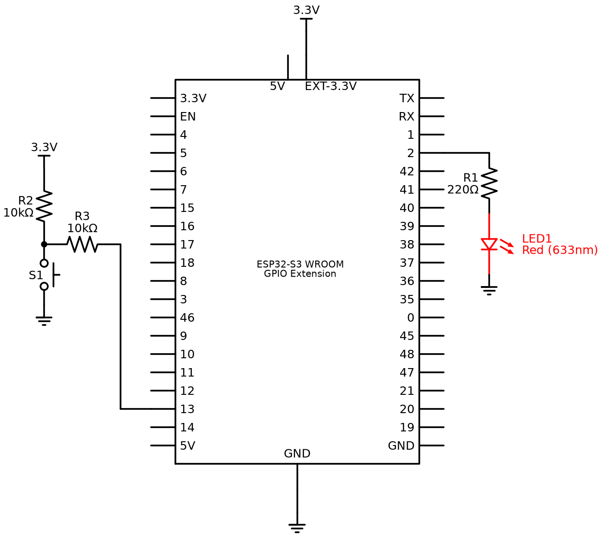

# Circuit

Schematic of the ESP32-S3 blinking LED circuit (GPIO2 → R1 → LED, button on GPIO13 with a pull-up).



## Regenerating the image

The schematic is drawn with [schemdraw](https://schemdraw.readthedocs.io/) from [src/circuit.py](src/circuit.py).
You need [uv](https://docs.astral.sh/uv/) installed; dependencies are installed automatically on the first run.

1. Edit `src/circuit.py`.
2. From this folder, run:

   ```
   uv run src/circuit.py
   ```

3. The image is written to `assets/lamp.png`. Commit it together with the source change.
